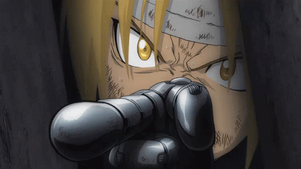
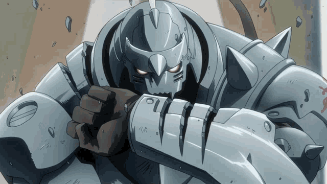
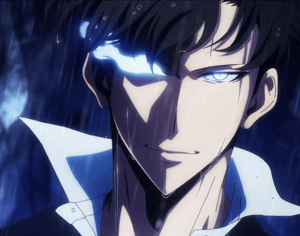
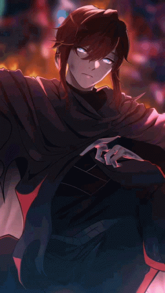

<h1 align="center">Olá, eu sou o HUG.</h1>

  <strong>Meus projetos nascem da vontade de ajudar.</strong> 
  Estudante de <strong>Engenharia de Software</strong>. 
  Gosto de criar soluções que simplificam as coisas e facilitam o dia a dia.

  <a href="#meu-laboratório">Tecnologias</a> &nbsp;·&nbsp;
  <a href="#projetos-em-transmutação">Projetos</a> &nbsp;·&nbsp;
  <a href="#meu-setup">Meu setup</a> &nbsp;·&nbsp;
  <a href="#universos-que-me-inspiram">Inspirações</a>

 

## Meu laboratório

  
  
  

## Projetos em transmutação

| Projeto | O que você encontra |
| :--- | :--- |
| 🎙️ **[LoL AI Coach](https://github.com/guhttps/lol-ai-coach)** | Coach de League of Legends com IA, interação por voz e overlay. Feito em Python. |
| ⚙️ **[BO2 + Plutonium](https://github.com/guhttps/bo2-plutonium-instalador)** | Assistente para Windows com download retomável e verificação de integridade. Feito em PowerShell. |
| 🎨 **[Casa Prática · Artes](https://github.com/guhttps/casa-pratica-achados-artes)** | Coleção de artes originais para a Casa Prática Achados. |

  <a href="https://github.com/guhttps?tab=repositories">Explorar meus repositórios →</a>

## Meu setup

| Componente | Hardware |
| :--- | :--- |
| Processador | AMD Ryzen 9 7900 · 12 núcleos / 24 threads |
| Placa de vídeo | NVIDIA GeForce RTX 4060 |
| Memória RAM | 32 GB DDR5 · 2 × 16 GB · 5200 MT/s |
| Placa-mãe | ASUS TUF GAMING B650M-PLUS |
| SSD 1 | XPG GAMMIX S70 BLADE · 1 TB |
| SSD 2 | ADATA IM2P33F3A NVMe · 512 GB |

## Universos que me inspiram

<table>
  <tr>
    <td align="center" width="50%">
      <a href="https://tenor.com/view/fullmetal-alchemist-edward-elric-fma-point-pointing-finger-gif-24131108">
         
        <strong>Edward Elric</strong>
      </a> 
      Fullmetal Alchemist
    </td>
    <td align="center" width="50%">
      <a href="https://tenor.com/view/fullmetal-alchemist-fullmetal-alchemist-brotherhood-fma-fmab-alphonse-gif-27596295">
         
        <strong>Alphonse Elric</strong>
      </a> 
      Fullmetal Alchemist
    </td>
  </tr>
  <tr>
    <td align="center" width="50%">
      <a href="https://tenor.com/view/jinwoo-sung-solo-leveling-jinwoo-anime-gif-4354532489944555106">
         
        <strong>Sung Jinwoo</strong>
      </a> 
      Solo Leveling
    </td>
    <td align="center" width="50%">
      <a href="https://tenor.com/view/arthur-tbate-gif-27260490">
         
        <strong>Arthur Leywin</strong>
      </a> 
      The Beginning After the End
    </td>
  </tr>
</table>

**Fullmetal Alchemist** é meu anime favorito: transformação com propósito e dedicação em cada troca equivalente. **Solo Leveling** me lembra de evoluir um passo de cada vez. **The Beginning After the End** traz a coragem para novos começos.

  GIFs encontrados no Tenor · Clique em cada personagem para ver a origem.

 

  A próxima transmutação começa com uma ideia.

