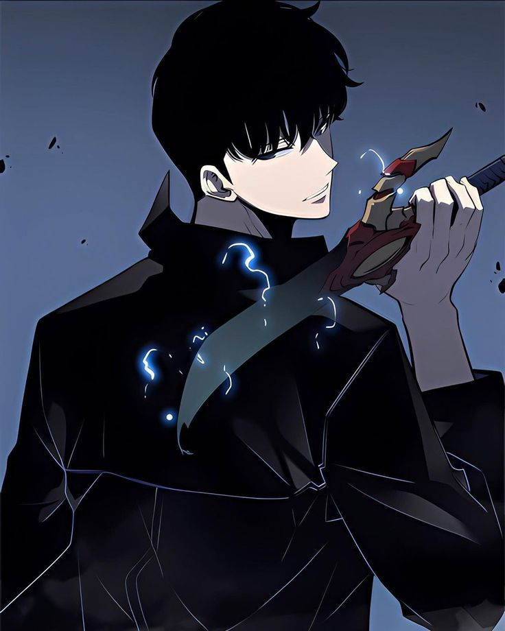

<h1 align="center">GUH.</h1>

<picture>
  <source media="(prefers-reduced-motion: no-preference)" srcset="https://raw.githubusercontent.com/guhttps/guhttps/main/assets/edward-elric.gif" type="image/gif" />
  
</picture>

  <strong>Meus projetos nascem da vontade de ajudar.</strong> 
  Estudante de <strong>Engenharia de Software</strong>. 
  Gosto de criar soluções que simplificam as coisas e facilitam o dia a dia.

  <a href="#meu-laboratório">Tecnologias</a> &nbsp;·&nbsp;
  <a href="#projetos-em-transmutação">Projetos</a> &nbsp;·&nbsp;
  <a href="#meu-setup">Meu setup</a> &nbsp;·&nbsp;
  <a href="#certificados">Certificados</a>

 

## Meu laboratório

<picture>
  <source media="(prefers-reduced-motion: no-preference)" srcset="https://raw.githubusercontent.com/guhttps/guhttps/main/assets/alphonse-elric.gif" type="image/gif" />
  
</picture>

  
  
  

 

## Projetos em transmutação

| Projeto | O que você encontra |
| :--- | :--- |
| 🖥️ **[Multiseat Windows](https://github.com/guhttps/multiseat-windows)** | Painel experimental para planejar duas estações no Windows, com instalador e ZIP disponíveis. Dois postos simultâneos já demonstrados no Windows Server em laboratório; teste físico em andamento. |
| 🎙️ **[LoL AI Coach](https://github.com/guhttps/lol-ai-coach)** | Coach de League of Legends com IA, interação por voz e overlay. Feito em Python. |
| 🛡️ **[Veu](https://github.com/guhttps/veu)** | Proxy, biblioteca Python e CLI para proteger dados pessoais antes de enviar textos a modelos de IA. |

### Multiseat Windows · projeto público

O objetivo é criar estações independentes no mesmo computador Windows, cada uma com sua conta, monitor, teclado e mouse. O código e a documentação já são públicos.

[Ver o projeto](https://github.com/guhttps/multiseat-windows) · [Código e documentação](https://github.com/guhttps/multiseat-windows/blob/main/README.md) · [Acompanhar o desenvolvimento](https://github.com/guhttps/multiseat-windows/issues)

**Situação atual (21/11/2026):** no Windows 11 Pro, a segunda conta chegou a fazer login na própria sessão, mas o Windows mantém uma única sessão interativa ativa. O projeto não altera o Windows para contornar esse limite de licença. [Resultados e limites](https://github.com/guhttps/multiseat-windows/blob/main/docs/lab/025-native-session-arbitration.md).

**Caminho escolhido: Windows Server.** Numa VM com Windows Server 2025, o cliente de postos rodou no próprio computador e conectou duas contas pelo endereço local. As três sessões ficaram ativas ao mesmo tempo, cada posto recebeu imagem, e a entrada de cada um chegou só ao aplicativo da própria conta. O próximo passo é o teste físico no PC, com dois monitores e dois teclados e mouses. [Resultados e limites](https://github.com/guhttps/multiseat-windows/blob/main/docs/lab/026-server-loopback-seats.md).

**Painel experimental disponível:** [baixar instalador Windows x64](https://github.com/guhttps/multiseat-windows/releases/download/v0.1.0-experimental.1/MultiseatPrototype-0.1.0-experimental.1-windows-x64-installer.exe) · [ZIP portátil e notas da versão](https://github.com/guhttps/multiseat-windows/releases/tag/v0.1.0-experimental.1) · [como instalar e usar](https://github.com/guhttps/multiseat-windows/blob/main/docs/DOWNLOAD-INSTALL.md). A instalação é por usuário, sem administrador. A versão é experimental, sem assinatura de código, e ainda não ativa estações independentes para jogos ou aplicativos externos.

**Laboratório do motor nativo:** a VM Windows cliente já tem checkpoint limpo e recuperação externa verificada em três cenários: prazo esgotado, perda do coordenador e tarefa benigna sem resposta. [Resultados e limites](https://github.com/guhttps/multiseat-windows/blob/4be9d2363b126c7856505923d50c581c17d2320d/docs/lab/009-native-h1-recovery.md). Essa etapa prepara a pesquisa; ainda não cria o segundo terminal nativo.

**Criação nativa de sessão:** uma solicitação limitada na VM cliente criou outra sessão com CSRSS e o processo inicial de teste, preservou o console original e terminou com restauração externa verificada. [Prova e limites](https://github.com/guhttps/multiseat-windows/blob/17e6000b5d0cdf27f5887e938b6521022a54adc5/docs/lab/010-native-session-creation.md). Esse resultado ainda não fornece login de uma segunda conta nem um posto com tela e entrada próprias.

**Motor nativo (29/10/2026):** o serviço real já completou o ciclo de recusa controlada de conexão, com o console preservado e restauração conferida. Uma candidata isolada de filas UMDF também carregou na VM e concluiu leituras, cancelamentos e duplicação de handles com dados do próprio teste. Isso ainda não comprova ligação à segunda sessão, entrada física ou frames de desktop. [Integração de entrada e limites](https://github.com/guhttps/multiseat-windows/blob/75a346b1bf3dd1d2cf3ef64e8ff163bd1de24d29/docs/lab/017-native-input-integration.md).

**Canal do núcleo e revisão atual (04/11/2026):** o serviço real recebeu os dois canais de GetInputHandles sob a atribuição viva da sessão. O fechamento dos arquivos e do cliente foi observado; console preservado, restauração e auditoria independente aprovadas. O ensaio completo ficou reprovado, com a observação válida verificada separadamente. O próximo bloqueio é GetHardwareId, da integração de display; leitura dos canais pelo kernel, segunda conta e dois terminais utilizáveis continuam pendentes. [Resultados e limites](https://github.com/guhttps/multiseat-windows/blob/5b5786572e1307f611ece1f7253643183607a96f/docs/lab/019-native-input-backend.md) · [Código do transporte](https://github.com/guhttps/multiseat-windows/tree/main/engine/native/ipc).

O teste físico com dois monitores e dois pares de teclado e mouse, o login de cada pessoa no próprio posto, o áudio por posto e a aceleração gráfica continuam pendentes. Duas contas de League of Legends ao mesmo tempo não estão validadas. O instalador disponível distribui o painel experimental e os diagnósticos.

<picture>
  <source media="(prefers-reduced-motion: no-preference)" srcset="https://raw.githubusercontent.com/guhttps/guhttps/main/assets/sung-jinwoo.gif" type="image/gif" />
  
</picture>

  <a href="https://github.com/guhttps?tab=repositories">Explorar meus repositórios →</a>

 

## Meu setup

<picture>
  <source media="(prefers-reduced-motion: no-preference)" srcset="https://raw.githubusercontent.com/guhttps/guhttps/main/assets/arthur-leywin.gif" type="image/gif" />
  
</picture>

| Componente | Hardware |
| :--- | :--- |
| Processador | AMD Ryzen 9 7900 |
| Placa de vídeo | NVIDIA GeForce RTX 4060 |
| Memória RAM | 32 GB DDR5 · 2 × 16 GB · 5200 MT/s |
| Placa-mãe | ASUS TUF GAMING B650M-PLUS |
| SSD 1 | XPG GAMMIX S70 BLADE · 1 TB |
| SSD 2 | ADATA NVMe · 512 GB |

 

## Certificados

| Curso | Instituição | Carga horária | Certificado |
| :--- | :--- | :---: | :--- |
| Linux Unhatched | Cisco Networking Academy · NDG | 8 horas | [Ver PDF](certificados/linux-unhatched.pdf) |
| Linguagem de Programação Python — Básico | Fundação Bradesco · Escola Virtual | 18 horas | [Ver PDF](certificados/python.pdf) |
| Fundamentos de TI: Hardware e Software | Fundação Bradesco · Escola Virtual | 7 horas | [Ver PDF](certificados/fundamentos-ti-hardware-software.pdf) |

  A próxima transmutação começa com uma ideia.

