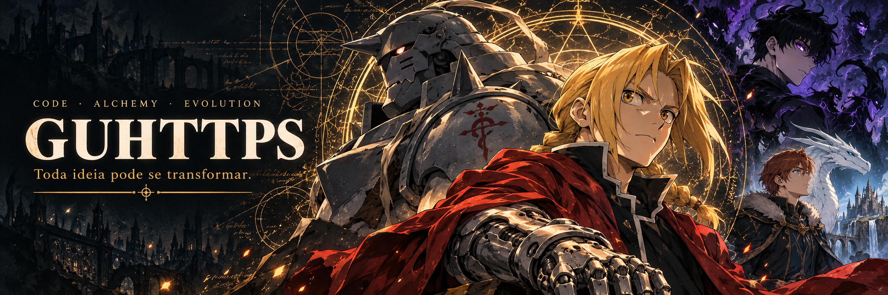

  

<h1 align="center">Olá, eu sou o HUG.</h1>

  <strong>Entre código, alquimia e novos mundos.</strong> 
  Por aqui, transformo ideias em projetos com Python, PowerShell e automação. 
  Fora do código, sempre cabe mais um episódio ou capítulo.

  <a href="#meu-laboratório">Tecnologias</a> &nbsp;·&nbsp;
  <a href="#projetos-em-transmutação">Projetos</a> &nbsp;·&nbsp;
  <a href="#universos-que-me-inspiram">Inspirações</a>

 

## Meu laboratório

  
  
  

Meus projetos passam por **IA aplicada a jogos**, **ferramentas para Windows** e **automação**. Gosto de ver uma ideia sair do papel e virar algo que dá para usar.

## Projetos em transmutação

| Projeto | O que você encontra |
| :--- | :--- |
| 🎙️ **[LoL AI Coach](https://github.com/guhttps/lol-ai-coach)** | Coach de League of Legends com IA, interação por voz e overlay. Feito em Python. |
| ⚙️ **[BO2 + Plutonium](https://github.com/guhttps/bo2-plutonium-instalador)** | Assistente para Windows com download retomável e verificação de integridade. Feito em PowerShell. |
| 🎨 **[Casa Prática · Artes](https://github.com/guhttps/casa-pratica-achados-artes)** | Coleção de artes originais para a Casa Prática Achados. |

  <a href="https://github.com/guhttps?tab=repositories">Explorar meus repositórios →</a>

## Universos que me inspiram

| Universo | O que levo comigo |
| :--- | :--- |
| 🔴 **Fullmetal Alchemist** · meu anime favorito | Transformação com propósito. Dedicação faz parte de toda troca equivalente. |
| 🟣 **Solo Leveling** | Evoluir, um passo de cada vez — e encarar o próximo desafio. |
| 🔵 **The Beginning After the End** | Coragem para novos começos e curiosidade por novos mundos. |

 

  <strong>APRENDER &nbsp;·&nbsp; CRIAR &nbsp;·&nbsp; EVOLUIR</strong> 
  A próxima transmutação começa com uma ideia.

